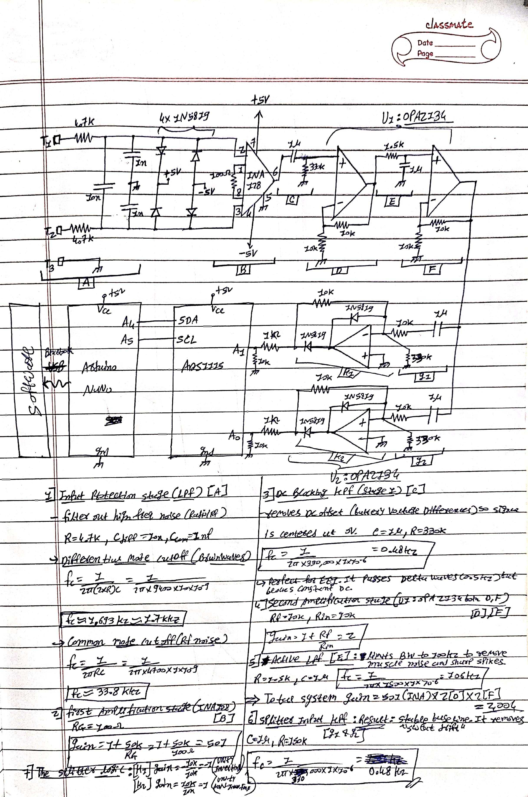
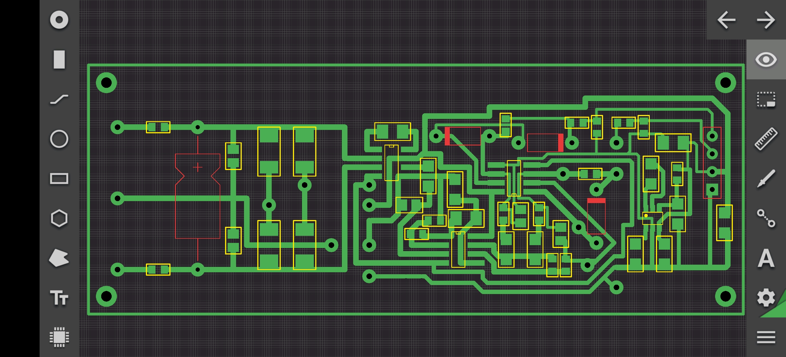
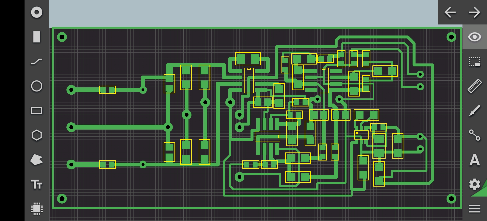
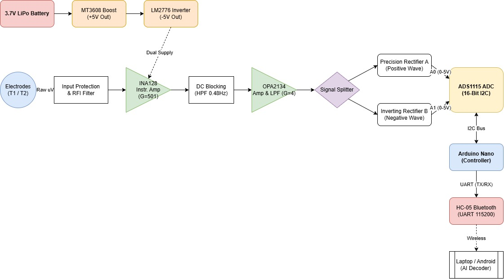
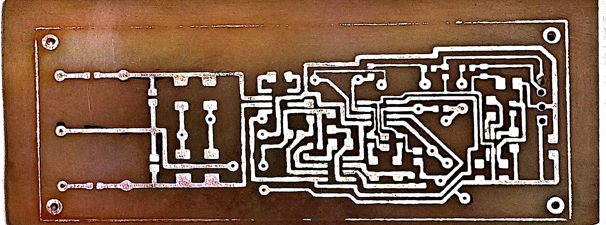
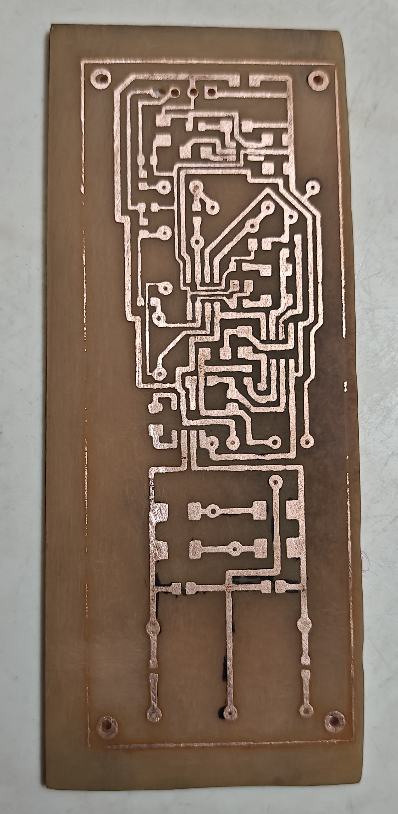

# Project Synapse v1 official : Real-Time Brainwave Decoder with Android
**Powered by the [mikey:hexoid-sys] Engine | Copyright (c) 2026 mikey-7x**


## ⚡ Overview
**Project Synapse v1 official** is an advanced, industrial-grade Brain-Computer Interface (BCI) and Subvocal Neuromuscular (sEMG) decoding system. It is a massive architectural evolution from the legacy real-time brainwave decoder repository.

This project captures microscopic biological signals (microvolts), amplifies them using a custom dual-supply analog front-end, digitizes them with a 16-bit ADC, and streams them wirelessly to an Android or PC terminal. The core of this system is the proprietary **`[mikey:hexoid-sys]` Trinx Engine**, a highly advanced artificial intelligence architecture that combines Autocorrelation, Dynamic Time Warping (DTW), and Deep Learning (CNN-LSTM/GRU) to decode raw human thoughts and subvocal speech into text with unparalleled precision.

---

## 🧬 The "Trinx" Paradigm & Project Evolution
Traditional Machine Learning and BCI systems rely on rigid, fixed-time data windows (e.g., forcing a brainwave into a strict 2-second array using zero-padding). This inherently destroys biological data because human thoughts are elastic. 

To solve this, Project Synapse developed the **"Trinx"** concept. A *Trinx* is defined as the pure, distinct structural shape of a thought or subvocalized word, regardless of its time interval. If thinking the word "YES" takes 0.8 seconds one time and 1.3 seconds the next, the *shape* remains the same, even if the time stretches.

### The Step-by-Step Evolution of the Engine:
1. **The Rigid Window Phase:** Early iterations relied on standard Keras deep learning arrays. Sudden high-amplitude noise caused filter "edge-ringing," resulting in zero-padding corruption and model crashes (Ghost Predictions).
2. **The Amplitude Trigger Flaw:** The system initially looked for sudden "spikes" to capture a thought. However, high-gain setups produced constant high-energy waves, causing the AI to extract only 1 sample per 60 seconds of training, resulting in failed model compilations.
3. **The Tsunami Bottleneck Fix:** Wireless Bluetooth transmission of 16-bit data caused TCP buffer overloads. The Android GUI would freeze and then release a "Tsunami" of delayed waveforms. This was solved by engineering a High-Speed Binary Batch Parser that aligns the `0xAA 0x55` sync bytes natively in micro-batches.
4. **The Final `[mikey:hexoid-sys]` Autocorrelation Architecture:** The engine now scans a full 60-second biological record. It mathematically overlaps the wave onto itself to find the exact dynamic repetition interval (periodicity). It dynamically slices the audio into exact intervals, cross-verifies the topological shape of each Trinx using Pearson Correlation, and feeds the pure, unpadded shapes into a custom Native DTW AI, while simultaneously generating synthetic augmented data for Keras CNN-GRU/LSTM compilation.

---

## ⚡ Hardware Architecture & Bill of Materials (BOM)
The custom analog front-end is designed to maximize Signal-to-Noise Ratio (SNR) and utilize Common-Mode Rejection (CMRR) to eliminate environmental RF noise.

### Core Components
* **Instrumentation Amplifier:** 1x INA128U/2K5 (SOIC-8)
* **Precision Op-Amps:** 2x OPA2134UA/2K5 (SMD-8)
* **ADC Module:** 1x ADS1115 (16-Bit I2C ADC)
* **Microcontroller:** 1x Arduino Nano (CH340)
* **Wireless Transceiver:** 1x HC-05 Bluetooth Module (6-pin)
* **Power Supply:** 1x 3.7V 500mAh Li-Poly Cell
* **Voltage Regulation:** 1x MT3608 Boost Module (Boosts to +5V) & 1x LM2776DBVR Inverter (Inverts +5V to -5V for a True Dual Supply)
* **Biological Interface:** Ag/AgCl Cup Electrodes

### Discrete Components & Passives
* **Capacitors:** 10nF polystyrene, 1nF (100v 0805), 1uF (X7R 1210), 10uF (25v 1210), 100nF (X7R 1206)
* **Resistors (High Precision 0.1%):** 100R, 1k, 1.5k, 4.7k, 10k, 330k, 1M (Yageo/Panasonic SMD)
* **Diodes:** 10x 1N5819 SMD Schottky (DO-214AC), 1N4148 (for precision rectifiers)

### Analog Signal Pipeline
1. **Input Protection & RFI Filter:** Passive RC filters (4.7k resistor, 10nF/1nF caps) and 1N5819 diode clamps protect the sensitive INA128 from static discharge and filter out high-frequency radio interference.
2. **First Amplification Stage:** The INA128 is configured with a 100-ohm gain resistor ($R_g$), providing a massive initial gain of ~501x.
3. **DC Blocking (High Pass Filter):** A 1uF capacitor and 330k resistor remove skin-battery DC offset (cutoff ~0.48Hz), re-centering the wave to 0V.
4. **Second Amplification & Active LPF:** The OPA2134 provides secondary gain and actively filters out high-frequency muscle artifacts (cutoff ~106Hz).
5. **Splitter & Precision Rectifier:** The signal is split. Because the ADS1115 operates on 0-5V and cannot read negative voltages, OPA2134 active rectifiers format the AC waveform into safe 0-5V positive and negative half-wave streams for pins A0 and A1.

---

## 🧲 Electrode Placement Guide
Skin preparation is mandatory. Use an alcohol wipe to remove skin oils and apply medical conductive gel to the Ag/AgCl electrodes to prevent infinite resistance.

* **Reference Electrode (GND):** Placed on the Mastoid process (the bony area directly behind the ear) or the collarbone. This provides the RF "Zero" baseline.
* **Active 1 (VIN+) & Active 2 (VIN-):**
  * **For Brainwaves (EEG):** Center of the forehead (Fp1 / Fp2). *Note: Keep eyes perfectly still to avoid EOG blink artifacts.*
  * **For Subvocal Speech (sEMG):** Left and right sides of the larynx/jaw. Provides immense microvolt spikes perfect for mapping spoken words.

---

## 💻 Software & AI Setup
The graphical interface and AI engine are executed in Python via PC or Termux/Pydroid on Android. 

**Model Architecture:**
* **Native Trinx-First Engine:** Custom AI utilizing Z-Score normalized Dynamic Time Warping (DTW) matrix math.
* **Deep Learning Cores:** Keras-based 1D-CNN + LSTM and 1D-CNN + GRU networks. The engine automatically synthesizes augmented data (Gaussian noise injection) to expand training sets.
* **Classical ML:** XGBoost, Random Forest, SVM, KNN, Logistic Regression running on 18-point statistically extracted feature vectors.

**To Run:**
1. Power the hardware and pair the HC-05 via Bluetooth.
2. Launch the TCP-Serial bridge on Android.
3. Execute `synapse.py`. Input your port (e.g., 5656) and click Connect.

---

# 📱 Installation & Execution Guide: Arch Linux (Termux)
**Project Synapse v1 official | Running the `[mikey:hexoid-sys]` Engine on Android**

Running a heavy machine learning Graphical User Interface (GUI) directly on an Android device requires bypassing Android's native limitations. We achieve this by utilizing **Termux**, **PRoot Arch Linux**, and **Miniforge (Conda)** to create a fully functioning desktop-class AI environment on an ARM64 processor.

Follow these instructions step-by-step to compile the AI cores and launch the Synapse GUI.

---

🛠️ Prerequisites
Before beginning, ensure you have installed the following apps on your Android device:
1. **Termux** (Download from F-Droid, *not* the Google Play Store).
2. **Termux:X11** (Required to display the Python GUI).

---

🚀 Step-by-Step Installation

Step 1: Install Arch Linux in Termux
Open the Termux app and install the PRoot Arch Linux distribution.
```bash
pkg update -y && pkg upgrade -y
pkg install proot-distro -y
proot-distro install archlinux
proot-distro login archlinux --shared-tmp

```
Step 2: Install System Dependencies
Once logged into the root@localhost Arch environment, install the core compilers, Git, and the Tkinter graphics libraries required by the GUI.
```bash
pacman -Syu --noconfirm
pacman -S --noconfirm base-devel git wget tk xorg-server-xvfb openblas hdf5

```
Step 3: Install Miniforge (Conda for ARM64)
Arch Linux enforces bleeding-edge Python versions (e.g., 3.14) which are incompatible with stable TensorFlow releases. We will install Miniforge to create an isolated Python 3.11 environment.
```bash
cd ~
wget "https://github.com/conda-forge/miniforge/releases/latest/download/Miniforge3-Linux-aarch64.sh"
bash Miniforge3-Linux-aarch64.sh -b
source ~/miniforge3/bin/activate
```
Step 4: Clone the Project Synapse Repository
Download the official source code to your local environment.
```bash
cd ~
git clone https://github.com/mikey-7x/Project-Synapse-v1-official-Real-Time-Brainwave-Decoder-with-Android.git
cd Project-Synapse-v1-official-Real-Time-Brainwave-Decoder-with-Android
```
Step 5: Create the AI Environment & Install Packages
Create a dedicated Conda environment locked to Python 3.11, then install the scientific, graphical, and Deep Learning dependencies.
```bash
conda install pip -y

# Create and activate the Python 3.11 environment
conda create -n synapse_tf python=3.11 -y
conda activate synapse_tf

# Upgrade Pip
pip install --upgrade pip

# Install Classical ML & Math Cores
pip install numpy pandas scipy matplotlib scikit-learn joblib xgboost

# Install Deep Learning Core (TensorFlow for ARM64)
pip install tensorflow

```
Execution: Running the Decoder
Every time you open Termux to run the Project Synapse GUI, you must connect to your X11 display server and activate the Conda environment.

**1. Start the Display Server in termux**
Open the **Termux:X11** app on your phone and leave it running in the background.
```
termux-x11 :0&
```

**2. Launch the Application**
Go back to your Termux terminal (ensure you are logged into Arch Linux) and run the following commands:
```
pd login Archlinux --shared-tmp
```

```bash
# Navigate to the project folder
cd ~/Project-Synapse-v1-official-Real-Time-Brainwave-Decoder-with-Android

# Activate the Miniforge AI environment
source ~/miniforge3/bin/activate
conda activate synapse_tf

# Route the graphics to Termux:X11
export DISPLAY=:0

# Launch the Project Synapse Engine
python synapse.py
```
make sure if your not bind "--shared-tmp" where login any proot-proot-distro linux, this will gives errors 

### 📡 Connecting to the Hardware
Once the GUI opens in your Termux:X11 window:
 1. Ensure your HC-05 Bluetooth module is powered and paired to your phone.
 2. Start your TCP-to-Serial background bridge (forwarding Bluetooth to port 5656).
 3. Click **CONNECT** in the Project Synapse GUI.
 4. The system will sync with the 0xAA 0x55 binary stream, and your brainwaves will appear on the screen!

---

## 📂 images
schematic:


layout:



flowchart:



physicall pcb:




---

## ⚠️ REGULATORY NOTICE & COMPLIANCE
**NOT CERTIFIED FOR MEDICAL, CLINICAL, OR INDUSTRIAL USE.**
This project, its schematics, PCB layouts, and software are strictly experimental prototypes. This device has **NOT** been evaluated, certified, or approved by the FCC, FDA, CE, or any other global or regional regulatory agency. It has not undergone formal electromagnetic compatibility (EMC) testing, medical safety isolation testing, or clinical trials. 

**CRITICAL SAFETY WARNING:** Never connect this device to mains power (wall outlets) or any device/computer that is plugged into mains power while the electrodes are attached to a human body. This device must strictly be operated on isolated, low-voltage battery power (e.g., 3.7V Li-Po) to prevent the risk of fatal electric shock.

---

## ⚖️ LEGAL DISCLAIMER & LIMITATION OF LIABILITY
**USE STRICTLY AT YOUR OWN RISK.**
The creator, author ("mikey-7x"), and any contributors to this repository provide this project, software, hardware designs, code, and documentation "AS IS", without warranty of any kind, express or implied, including but not limited to the warranties of merchantability, fitness for a particular purpose, safety, and non-infringement.

IN NO EVENT SHALL THE AUTHOR, CREATOR, OR CONTRIBUTORS BE HELD LIABLE FOR ANY CLAIM, DAMAGES, INJURY (INCLUDING INJURY, BRAIN DAMAGE, OR DEATH RESULTING FROM ELECTRIC SHOCK OR HARDWARE MALFUNCTION), OR OTHER LIABILITY, WHETHER IN AN ACTION OF CONTRACT, TORT, OR OTHERWISE, ARISING FROM, OUT OF, OR IN CONNECTION WITH THE SOFTWARE, HARDWARE, EXPERIMENTATION, ASSEMBLY, OR THE USE OR OTHER DEALINGS IN THIS PROJECT. 

By building, running, downloading, or interacting with Project Synapse in any way, you explicitly acknowledge and agree that you assume 100% of the risk, responsibility, and liability for your actions.

---

## 📜 License & Copyright
**Copyright (c) 2026 mikey-7x. All rights reserved.**

This project is licensed under the **Creative Commons Attribution-NonCommercial 4.0 International (CC BY-NC 4.0)** License.

**Under this license, you are free to:**
* **Share** — copy and redistribute the material in any medium or format.
* **Adapt** — remix, transform, and build upon the material for personal, hobbyist, or academic purposes.

**Under the following terms:**
* **Attribution** — You must give appropriate credit to "mikey-7x", provide a link to the license, and indicate if changes were made.
* **NonCommercial (Strictly Enforced)** — You may **NOT** use the material for commercial purposes. You cannot manufacture and sell this hardware, you cannot sell this software, and you cannot use the `[mikey:hexoid-sys]` engine or its derivatives in any monetized, ad-supported, funded, or profit-generating application.

### 💼 Commercial Licensing (Dual-License)
Project Synapse is strictly protected against unauthorized corporate use. If you are a corporation, startup, medical entity, or individual who wishes to utilize Project Synapse, its schematics, or the proprietary `[mikey:hexoid-sys]` AI architecture for commercial purposes, you must obtain explicit, written legal permission. Please contact the author directly to negotiate a commercial license agreement.

auther Gmail id:
chauhanyogesh9825@gmail.com
