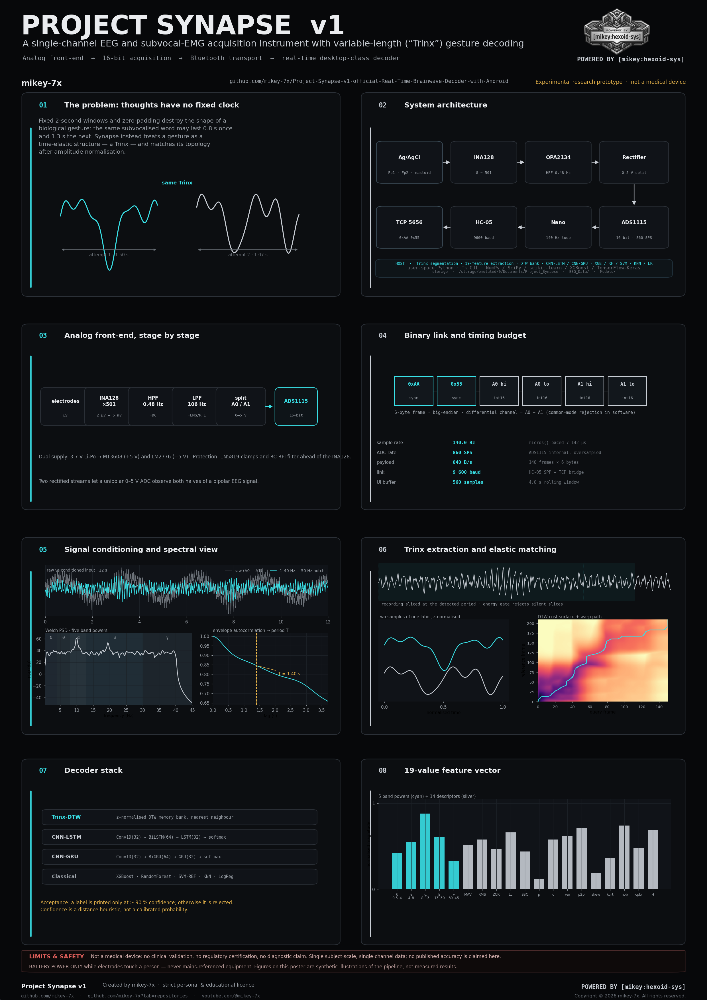

<div align="center">


# Project Synapse v1

**A single-channel EEG and subvocal-EMG acquisition instrument with variable-length gesture decoding.**


`POWERED BY [mikey:hexoid-sys]`

</div>

> [!WARNING]
> **Experimental electronics. Not a medical device.**
> No clinical validation, no regulatory certification, no accuracy claim.
> Operate on **battery power only** while electrodes touch a person. Read
> [SAFETY.md](SAFETY.md) and [LIMITATIONS](docs/LIMITATIONS.md) before building anything.

---

## What this is

Project Synapse is a complete, buildable acquisition chain for very small biological
potentials: a discrete analog front-end, a 16-bit ADC sampled by an Arduino Nano, a
Bluetooth binary link, and a desktop-class Python application that segments, features and
classifies the incoming signal on an Android phone or a Linux machine.

It is presented as an engineering study: instrumentation design, a wire protocol, a
signal-processing pipeline and a small-multiple comparison of classical and deep-learning
decoders. It is **not** a product and **not** a brain-reading device.

| Layer | Implementation |
| --- | --- |
| Electrodes | Ag/AgCl cup electrodes, three-wire placement |
| Analog front-end | INA128 instrumentation amplifier (G = 501), OPA2134 stages, 0.48 Hz high-pass, ~106 Hz low-pass, precision rectifiers |
| Conversion | ADS1115, 16-bit, ±6.144 V range, 860 SPS internal rate |
| Acquisition | Arduino Nano (ATmega328P), microsecond-paced loop at **140 Hz** |
| Transport | HC-05 Bluetooth SPP → TCP bridge on port **5656**, 6-byte frames |
| Host | Python 3.11 · Tk GUI · NumPy / SciPy / scikit-learn / XGBoost / TensorFlow |
| Decoders | Trinx-DTW memory bank, CNN-LSTM, CNN-GRU, XGBoost, Random Forest, SVM, KNN, logistic regression |
| Storage | `/storage/emulated/0/Documents/Project_Synapse/{EEG_Data,Models}` |

## Research poster

[](assets/scientific-poster.pdf)

A2 print-ready poster (PNG + PDF) in [`assets/`](assets/): the signal chain, the timing
budget, the Trinx segmentation method, the DTW cost surface, the decoder stack and the
honest limits, on one page. Figures are deterministic illustrations of the pipeline, not
measured results.

## Repository map

| Path | Contents |
| --- | --- |
| `synapse.py` | Engine build v18 — all-in-one master core (acquisition, dashboard, Trinx extraction, training, prediction) |
| `next_synapse.py` | Engine build v19 — same pipeline with adjusted model hyper-parameters and extraction refinements |
| `sketch_mar20b.ino` | Firmware: ADS1115 dual-channel read, 140 Hz pacing, `0xAA 0x55` framing over serial |
| `sketch_mar29a.cpp.hex` | Prebuilt AVR binary produced from the acquisition sketch (legacy filename) |
| `ps.jpg`, `psl*.jpg`, `pss.jpg`, `pss2.pdf` | Schematic, PCB layout, physical board and flow-chart figures |
| `PROJECT SYNAPSE.BMP`, `project synapse original.jpg` | Original project artwork |
| `assets/` | Brand files, poster, checksums and the asset guide |
| `docs/` | Hardware, protocol, algorithm, setup, usage, limitations, troubleshooting |
| `tools/verify_repository.py` | Offline self-check (structure, branding, licence, syntax, assets) |
| `tools/make_poster.py` | Deterministic generator for the research poster |
| `.github/` | CI checks, issue forms, pull-request template |

## Signal chain in numbers

```text
electrodes          INA128 (G = 501)      OPA2134 HPF 0.48 Hz    LPF ~106 Hz
   ↓                      ↓                      ↓                    ↓
µV-scale            first gain stage       DC / skin battery     muscle & RFI
                                                                        ↓
ADS1115 A0 / A1  ←  precision rectifiers (0–5 V)  ←  splitter  ─────────┘
   ↓  16-bit, 860 SPS
Arduino Nano  →  `AA 55 | A0 hi | A0 lo | A1 hi | A1 lo`  →  140 frames/s  →  HC-05
   ↓  9600 baud serial
TCP 5656  →  Python host  →  notch 50 Hz · 1–40 Hz band-pass  →  4 s buffer (560 samples)
```

Design details, gain and filter arithmetic: **[docs/HARDWARE.md](docs/HARDWARE.md)**.
Protocol, frame timing and the bandwidth budget: **[docs/PROTOCOL.md](docs/PROTOCOL.md)**.

## The Trinx idea

Fixed-length windows and zero-padding destroy the shape of a biological gesture: the same
subvocalised word can last 0.8 s once and 1.3 s the next. Synapse instead measures the
**period** of the recording from the autocorrelation of its envelope, slices the stream at
that period, z-normalises each slice, and compares slices as elastic shapes using dynamic
time warping. A slice is a *Trinx* — a time-normalised gesture template.

```text
60 s recording → envelope → autocorrelation → period T (0.5–3.0 s)
      → slices of length T → energy gate → z-normalised Trinx bank
      → DTW nearest-neighbour  |  padded tensors for CNN-LSTM / CNN-GRU
      → 19-feature vectors for XGBoost / RF / SVM / KNN / logistic regression
```

Full method, parameters, the 19-feature definition and the acceptance rule:
**[docs/ALGORITHM.md](docs/ALGORITHM.md)**.

## Getting started on Android (Termux)

```bash
pkg update -y && pkg upgrade -y
pkg install proot-distro termux-x11-nightly -y
proot-distro install archlinux
proot-distro login archlinux --shared-tmp
```

Inside Arch Linux:

```bash
pacman -Syu --noconfirm
pacman -S --noconfirm base-devel git wget tk xorg-server-xvfb openblas hdf5
wget "https://github.com/conda-forge/miniforge/releases/latest/download/Miniforge3-Linux-aarch64.sh"
bash Miniforge3-Linux-aarch64.sh -b
source ~/miniforge3/bin/activate
git clone https://github.com/mikey-7x/Project-Synapse-v1-official-Real-Time-Brainwave-Decoder-with-Android.git
cd Project-Synapse-v1-official-Real-Time-Brainwave-Decoder-with-Android
conda create -n synapse_tf python=3.11 -y && conda activate synapse_tf
pip install --upgrade pip
pip install numpy pandas scipy matplotlib scikit-learn joblib xgboost tensorflow
```

Run it:

```bash
termux-x11 :0 &                    # in Termux, Termux:X11 app in the background
proot-distro login archlinux --shared-tmp
cd ~/Project-Synapse-v1-official-Real-Time-Brainwave-Decoder-with-Android
source ~/miniforge3/bin/activate && conda activate synapse_tf
export DISPLAY=:0
python synapse.py
```

Always use `--shared-tmp`; without it the PRoot session and the X11 socket cannot see each
other. Full walk-through, desktop alternative and troubleshooting:
**[docs/ANDROID-SETUP.md](docs/ANDROID-SETUP.md)** and **[docs/TROUBLESHOOTING.md](docs/TROUBLESHOOTING.md)**.

## Using the application

1. Power the analog board from its battery and pair the HC-05 to the phone.
2. Start the Bluetooth-to-TCP bridge so the app can open `127.0.0.1:5656`.
3. Launch the engine, press **CONNECT** — the parser locks onto the `0xAA 0x55` sync words.
4. Prepare skin, attach electrodes, keep still; watch the live trace and band powers.
5. Name a label, record the requested strips, and start training.
6. Switch on prediction. A label is shown only when the confidence heuristic reaches 90 %;
   otherwise the frame is rejected.

Step-by-step: **[docs/USAGE.md](docs/USAGE.md)**.

## What this project does *not* claim

- It does not read thoughts, words or intentions reliably. It classifies a small set of
  self-recorded, self-labelled gestures, and its own acceptance rule rejects most frames.
- It has never been evaluated by an ethics board, a clinician or a metrology laboratory.
- It is single-channel, 140 Hz, unshielded, hobby-grade hardware: motion, blink, mains and
  electrode-contact artefacts dominate the signal far more often than neural activity.
- The figures published here illustrate the processing chain; they are not accuracy results.

The full list, including the anti-alias and link-margin caveats: **[docs/LIMITATIONS.md](docs/LIMITATIONS.md)**.

## Safety, licensing and credit

| Document | Purpose |
| --- | --- |
| [SAFETY.md](SAFETY.md) | Electrical isolation, electrode handling, consent, stop rules |
| [LICENSE.md](LICENSE.md) | Strict personal & educational licence; commercial and clinical use need written permission |
| [NOTICE.md](NOTICE.md) | Required attribution text and logo usage |
| [AUTHORS.md](AUTHORS.md) | Author identity and official links |
| [CHANGELOG.md](CHANGELOG.md) | What changed in this revision and why |

**Created by mikey-7x** — the author identity used across every repository of this account
(short form “mikey”). No personal name or email address is published.

Thanks are due to the maintainers of Arduino, Adafruit (ADS1X15 library), NumPy, SciPy,
scikit-learn, XGBoost, TensorFlow/Keras, matplotlib, Termux, PRoot, Arch Linux and
Miniforge. Their work remains under their own licences.

<div align="center">


**`POWERED BY [mikey:hexoid-sys]`**

Copyright © 2026 mikey-7x. All rights reserved.

[Profile](https://github.com/mikey-7x) ·
[All repositories](https://github.com/mikey-7x?tab=repositories) ·
[YouTube](https://youtube.com/@mikey-7x) ·
[Blog](https://rtod-yv8.blogspot.com/?m=1)

<sub>Non-commercial licence. No clinical or regulatory approval. Not affiliated with or
endorsed by any vendor named above.</sub>

</div>

<details>
<summary>Original project artwork</summary>


</details>
